# 脑机接口十讲：重点笔记

## 1. 脑机接口概览

**基本流程**：采集脑信号 → 预处理 → 提取特征 → 解码 → 设备动作 → 用户反馈。

- 解码：从神经活动估计意图、状态或刺激类别。
- 闭环：用户根据设备反馈调整活动，系统继续解码。实际效果受准确率、延迟和用户适应共同影响。
- 运动控制负责执行意图；感觉反馈提供接触、力度等信息，帮助修正动作。

| 方法 | 测量对象 | 主要特点 |
|---|---|---|
| EEG | 头皮电位差 | 时间分辨率高、便携，空间混合明显 |
| MEG | 神经电流产生的磁场 | 时间分辨率高，需抑制环境磁噪声 |
| BOLD-fMRI | 血氧相关 MRI 信号变化 | 空间定位较细，血流响应慢 |
| fNIRS | 光吸收反映的血红蛋白变化 | 可穿戴，主要对浅层组织敏感 |
| PET | 放射性示踪剂分布 | 研究代谢或特定分子过程 |
| ECoG | 皮层表面电位 | 更接近来源，需要手术 |
| 皮层内微电极 | 局部细胞外电活动 | 可记录尖峰、局部场电位，需要植入 |

**时间分辨率**：能分辨多快的变化。**空间分辨率**：能区分多近的来源。

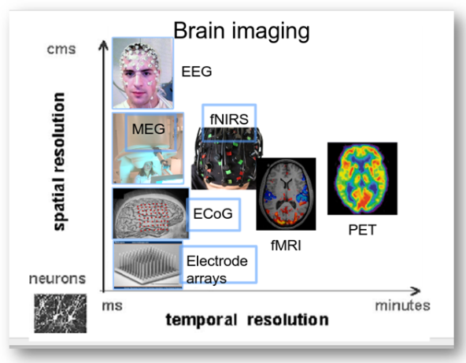

**图 1｜各类脑接口的时空分辨能力。** 来源：第 1 讲第 33 页

图中越往左时间越精细，越往下空间越精细。设备选择还要考虑覆盖范围、便携性和侵入程度。

周围神经接口：袖套电极包绕神经，神经内电极进入神经束。**RPNI** 让周围神经重新支配移植肌肉，通过肌肉信号获得控制信息。

## 2. 机器学习与表示空间

### 任务与学习方式

| 名词 | 原理或目标 |
|---|---|
| 分类 | 预测离散类别，如左右手 |
| 回归 | 预测连续数值，如光标速度 |
| 聚类 | 按相似性分组，组别含义需结合任务解释 |
| 监督学习 | 用输入和对应标签训练 |
| 无监督学习 | 从无标签数据中寻找结构 |
| 自监督学习 | 从数据自身构造目标，如预测被遮住的片段 |
| 强化学习 | 根据行动后的奖励学习策略 |

机器学习属于 AI；深度学习使用多层神经网络。任务、学习方式和网络结构分别描述“输出什么”“怎样获得训练信号”“怎样计算”。

### 构造空间，提高可分性

把 EEG 矩阵 X 转为特征向量 z=f(X)，每个特征就是一个新坐标。目标是保留任务信息，让不同类别更容易区分，同时减少无关的个体、日期变化。

- **表示学习**：从数据学习特征；分类器再根据特征判断类别。
- **PCA**：保留方差较大的方向，用于降维。高方差方向与类别差异未必一致。
- **CSP**：学习通道加权组合，使两类信号的方差差异突出，常用于运动想象 EEG。

### 常见模型

| 模型 | 基本做法 | 用处 |
|---|---|---|
| 线性模型 | 特征加权求和，如 s=w₁L+w₂R+b | 简单、计算量小，适合作基线 |
| 决策树 | 按特征阈值逐层分支 | 形成可追踪的判断规则 |
| 随机森林 | 多棵随机化决策树综合投票 | 减少对单棵树的依赖 |
| SVM | 权衡分类间隔与错误；核方法形成非线性边界 | 在特征空间中区分类别 |
| 神经网络 | 多层可学习变换，通常包含非线性运算 | 学习复杂特征和输入输出关系 |
| CNN | 同一卷积核在不同位置复用 | 提取局部波形、图像或通道组合特征 |
| RNN | 通过内部状态传递历史信息 | 处理连续时间序列 |
| GRU/LSTM | 用门控调节信息保留与更新 | 改善序列中历史信息的利用 |
| 注意力 | 按内容给不同位置分配权重 | 汇集与当前预测有关的信息 |

### 训练与评估

- **损失函数**衡量预测与目标的差距；**反向传播**计算参数梯度；优化器据此更新参数。
- **学习率**控制更新幅度：过大容易不稳定，过小训练慢。
- 训练集更新参数，验证集选模型，测试集评估最终效果。
- **过拟合**：训练表现好，新数据表现差。常用处理有合理划分、正则化、早停和控制模型容量。
- 准确率看猜对多少，损失还可考虑概率。两次都猜对，置信度不同，损失也不同。

## 3. 信号处理

### 采样与混叠

- 信号频率：每秒振荡次数。10 Hz 的周期是 0.1 秒。
- 采样率：每秒记录次数。250 Hz 的采样间隔是 4 ms。
- 采样使时间离散，量化使幅值进入有限等级。
- 8 通道、250 Hz、2 秒，对应 8×500 的输入矩阵。
- **混叠**：采样过慢，高频与低频产生相同采样值，原频率无法区分。
- 理想带限信号要求 fs>2fmax，实际留出滤波余量；采样前先抗混叠滤波。
- 降采样前先低通，插值只增加点数，无法恢复未记录的信息。

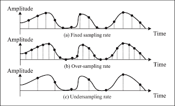

**图 2｜采样点变稀时会丢失波形线索。** 来源：第 3 讲第 48 页。

### 时域、频域、时频域

| 表示 | 观察内容 |
|---|---|
| 时域 | 波形随时间的变化、峰值和潜伏期 |
| 频域 | 各频率成分的强弱 |
| 时频域 | 各频率在什么时间出现或增强 |

**傅里叶变换**把信号分解为频率成分。一般波形重建需要幅度与相位。

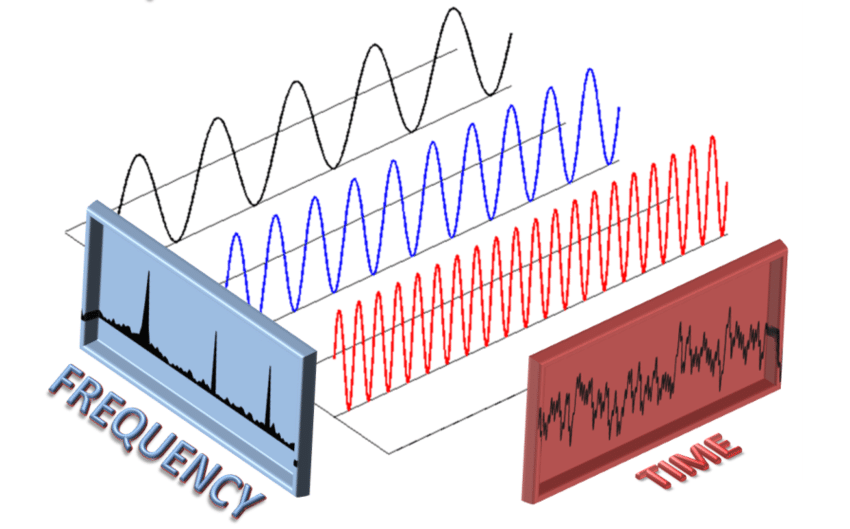

**图 3｜同一信号的时域与频域视角。** 来源：第 3 讲第 40 页。

**短时傅里叶变换**逐窗计算频谱，形成谱图。短窗时间定位好，长窗更利于区分相近频率；频率格点间隔约为 1/窗长。

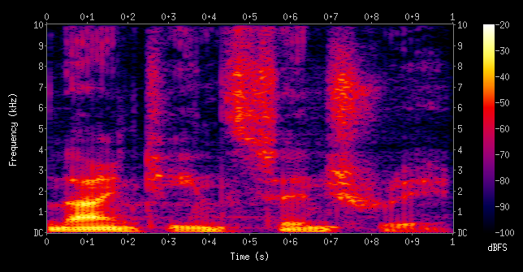

**图 5｜谱图把频率变化放回时间轴。** 来源：第 3 讲第 45 页。

谱图横轴时间、纵轴频率、颜色表示强度。这幅课件图用 kHz、dBFS，是通用示例；横向亮带表示持续频率成分。

### 卷积与滤波

**卷积**用一组权重组合输入样本。三点平均把最近三个值相加除以 3，可平滑波动，也会压低短暂峰值。

| 滤波方式 | 保留内容 | 常见用途 |
|---|---|---|
| 低通 | 低频 | 抑制高频波动 |
| 高通 | 高频 | 去除缓慢漂移 |
| 带通 | 指定频段 | 提取目标频段活动 |
| 陷波 | 狭窄频段以外的成分 | 抑制 50/60 Hz 工频 |

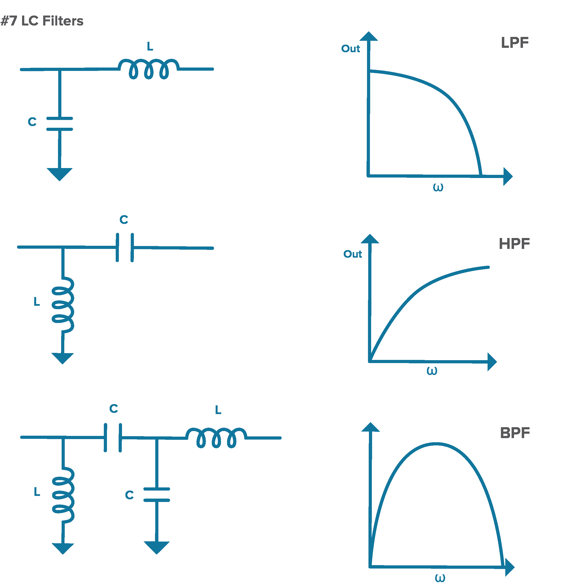

**图 4｜低通、高通与带通的频率响应。** 来源：第 3 讲第 38 页。

滤波器有过渡带和相位、延迟影响。眼动、肌电与目标频段重叠时，要结合其他伪迹处理。

**因果系统**只用当前及过去数据；使用未来样本的离线处理，在线部署时需调整。

### 幅值与功率

有限记录的平方和 E=Σ|x[n]|²，平均平方值 P=E/N。幅值变为 3 倍，平方量变为 9 倍。物理单位取决于测量量及计算方式。

## 4. 神经科学基础

### 神经元与编码

- 树突接收输入，胞体整合，轴突传递活动，突触影响下一细胞。
- 动作电位达到阈值后呈“全或无”，经历去极化、复极化和恢复。
- 信息由放电率、尖峰时间和群体模式承载。0.5 秒出现 20 个尖峰，放电率为 40 次/秒。
- EEG 主要反映大量神经元突触活动形成的综合电场，受同步程度、方向和时序等影响。
- **群体编码**：多个神经元的响应组合表示运动方向等变量。

### ERP 与常见成分

**ERP（事件相关电位）**：把多次记录按事件起点对齐并平均，突出时间一致的响应。反应时刻分散会摊平峰值，同步伪迹也会保留。

| 成分 | 近似时间与方向 | 常见研究内容 |
|---|---|---|
| P300/P3 | 约 300 ms，正向 | 目标检测、注意、情境更新 |
| N100/N1 | 约 100 ms，负向 | 早期感觉加工 |
| N170 | 约 170 ms，负向 | 面孔加工 |
| N400 | 约 400 ms，负向 | 语义加工 |

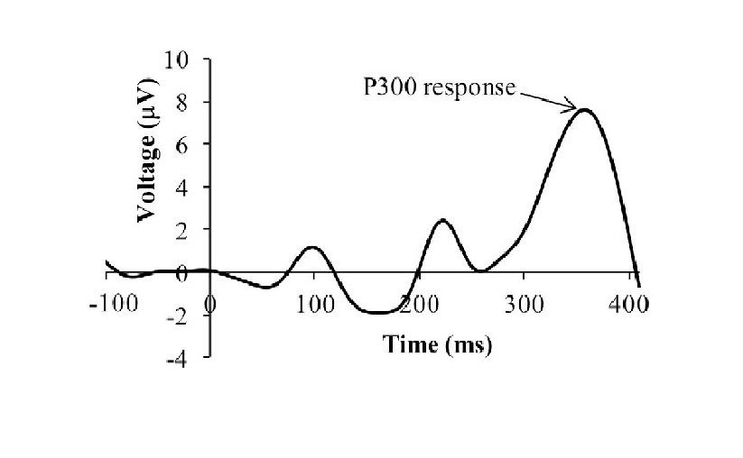

**图 6｜P300：以事件起点对齐的电位变化。** 来源：第 4 讲第 45 页。

潜伏期随任务和个体变化。读图先看坐标方向与参考；部分 ERP 图将负向朝上。

### 可塑性与用户学习

**神经可塑性**：经验和活动改变连接或功能。LTP 是长期增强，LTD 是长期抑制。

BCI 成绩提升可来自模型更新和用户学习。神经反馈让用户根据实时反馈练习调节活动；区分两者贡献时，要记录模型与校准是否改变。

## 5. 六篇论文重点

先分清三个环节：编码器提取表示，解码器预测目标，生成模型利用条件和已有规律生成输出。

**GAN**通过生成器、判别器对抗训练学习分布；**扩散模型**通过逐步去噪生成内容；**语言模型**利用词句规律辅助生成或纠错。

### 5.1 手写转文字

[High-performance brain-to-text communication via handwriting](https://www.nature.com/articles/s41586-021-03506-2)，Willett 等，2021。课件 13–32 页。

- **贡献**：利用尝试手写时丰富的神经时间轨迹，直接识别字符。
- **数据**：1 名四肢瘫痪参与者 T5，运动皮层两块微电极阵列。
- **方法**：20 ms 窗口统计阈值交叉事件并平滑；两层 GRU 输出字符概率和字符起始概率。课件记录输出延迟约 1 秒。
- **结果**：约 90 字符/分钟，94.1% 原始在线准确率；语言纠错后的回顾性结果超过 99%。
- **实验条件**：测试未参与训练的句子，包含每日校准。字符错误率计入替换、删除和插入。

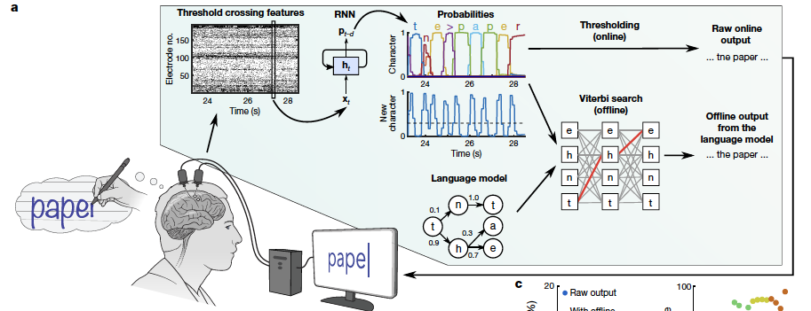

**图 7｜手写论文：直接解码与语言纠错分支。** 来源：第 5 讲第 20 页，Willett 等（2021）。

上路直接输出字符，下路加入语言纠错，分别对应两种成绩。

**时间扭曲对齐**按书写进度比较活动，减少快慢差异；训练结合单字母、句子与合成句子数据。

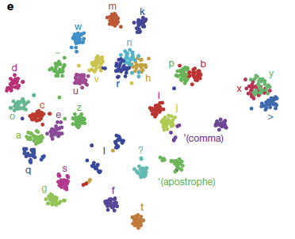

**图 8｜手写论文：字符相关神经表示的 t-SNE 图。** 来源：第 5 讲第 24 页，Willett 等（2021）。

**t-SNE**将高维表示映射到二维，便于观察字符聚类；二维距离经过变换，泛化效果看独立测试。

与表示学习的联系：保留整段轨迹中的字符差异，减少书写速度带来的变化。

### 5.2 语音解码与虚拟人

[A high-performance neuroprosthesis for speech decoding and avatar control](https://www.nature.com/articles/s41586-023-06443-4)，Metzger 等，2023。课件 33–43 页。

- **贡献**：尝试说话的皮层活动同时支持文字、声音和面部动画。
- **数据**：1 名瘫痪参与者，253 通道高密度 ECoG，覆盖言语相关皮层。
- **文字路线**：神经特征 → 音素概率 → 词典及语言模型 → 句子。
- **声音路线**：神经特征 → 离散语音单元 → 声学表示 → 声码器。
- **动画路线**：预测发音、面部动作表示，再恢复轨迹驱动虚拟人。
- **结果**：课件报告约 78 词/分钟、约 25% 词错误率。声音另评可懂度、音质，动画另评口型与同步。

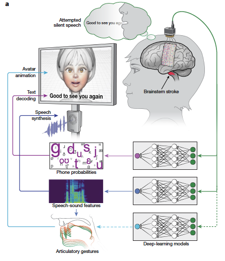

**图 9｜语音论文：文字、声音与虚拟人三条输出路线。** 来源：第 5 讲第 35 页，Metzger 等（2023）。

几个方法名：

- **CTC**：合并多种序列对齐路径，用整段神经信号和文本训练，省去逐帧音素标注。
- **WFST**：把发音、词典和语言规则组织成搜索结构；4-gram 与 RNN 重评分帮助选候选句子。
- **HuBERT**：预训练语音模型，用于提取语音单元，提供解码目标。
- **VQ-VAE**：用有限码本表示连续模式，再恢复动作，便于学习中间表示。

音色由额外的声音转换处理。音画任务可借鉴共同内容表示与时间对齐，词表、延迟和校准条件按具体实验记录。

### 5.3 低密度 EEG 图像分类与重建

[Image classification and reconstruction from low-density EEG](https://www.nature.com/articles/s41598-024-66228-1)，Guenther 等，2024。课件 44–53 页；流程沿用此前核对的原论文。

- **贡献**：先用分类学习 EEG 表示，再用该表示引导预训练扩散模型。
- **数据**：招募 9 人，8 人进入主要分类分析；20 类、600 张图片。显示 2 秒、灰屏 1 秒，8 通道、250 Hz，输入 8×500。
- **划分**：按记录场次分训练、验证、测试，各参与者分别建模。
- **预处理**：坏试次检查，1 Hz 高通、95 Hz 低通、60 Hz 陷波，逐通道标准化及限幅；滤波先于试次切分。
- **表示**：比较多个分类网络后，以 EEGNet 学习 512 维嵌入，再移除分类层。
- **生成**：同一 EEG 嵌入经交叉注意力和扩散时间步嵌入两条路径输入生成模型。训练更新编码器、投影器和指定注意力模块。

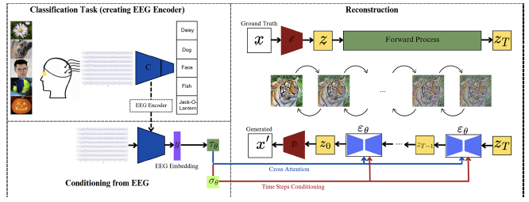

**图 10｜图像论文：分类表示如何进入扩散模型。** 来源：第 5 讲第 49 页，Guenther 等（2024）。

**EEGNet** 是紧凑 CNN，学习时间特征和通道组合；512 维嵌入用于保留类别线索。扩散时间步指去噪步骤。

| 结果 | 评估条件 |
|---|---|
| 34.4% | 20 类 EEG 分类，参与者平均；均匀随机水平为 5% |
| 35.3% | 基础集重建，50 类 top-1，每试次五次生成取最佳 |
| 30.9% | 基础集五次生成的平均结果 |
| 8.2% | 未见类别重建，最佳样本结果 |

主要重建实验使用表现最好的参与者。控制输入的成绩下降，支持 EEG 提供有效信息；图像细节同时受到生成先验影响。类别识别、细节还原和新类别泛化分别评价。

### 5.4 EEG 情绪识别综述

[Role of machine learning and deep learning techniques in EEG-based BCI emotion recognition system: a review](https://link.springer.com/article/10.1007/s10462-023-10690-2)，Samal、Hashmi，2024。课件 54 页，内容含原文补充。

- 纳入 209 篇文献，整理情绪定义、刺激、数据集、特征和分类路线。
- 情绪可分离散类别，也可用维度表示：valence（愉悦程度）、arousal（唤醒程度）、dominance（控制感）。
- 刺激类别与本人情绪评分对应不同标签来源；评分阈值和时间要记录。
- 比较模型前先看标签定义、跨人划分和刺激是否重复。

### 5.5 跨天对齐与固定解码器

[Using adversarial networks to extend brain computer interface decoding accuracy over time](https://elifesciences.org/articles/84296)，Ma、Rizzoglio 等，2023。课件 55–61 页。

- **贡献**：转换新一天的神经输入，继续使用原有解码器。
- **数据**：多只猴的皮层内群体活动、多种运动任务，预测肌电或运动学量。课件 95 天指时间跨度。
- **流程**：第 0 天有标签训练 Wiener 解码器并固定；第 k 天用无标签数据学习对齐，再预测连续输出，用 R² 评价。

| 方法 | 原理 |
|---|---|
| PAF | 因子分析降维，再作 Procrustes 几何对齐 |
| ADAN | 利用自编码器相关结构进行对抗域适应 |
| Cycle-GAN | 学习新旧两天双向映射，以循环一致性约束信息保留 |

**循环一致性**：新数据变到旧域再变回来，应接近原输入。对抗目标调整分布，行为预测检验任务信息是否保留。

课件同日基线 R² 约 0.71–0.73；跨天直接使用会退化。两种对抗方法总体优于所比较的 PAF，Cycle-GAN 在长期、连续数据场景中更稳健。

新一天对齐不用动作标签，第 0 天训练和评价仍使用行为数据。适用性取决于新旧数据的对应结构。表示学习要同时兼顾类别可分性和跨天一致性。

### 5.6 运动想象 EEG 方法综述

[Machine learning techniques for electroencephalogram based brain-computer interface: A systematic literature review](https://doi.org/10.1016/j.measen.2023.100823)，Pawan、Dhiman，2023。课件 62–63 页。

- 总结超过 220 篇论文，整理采集、预处理、特征与分类，包括小波、小波包等时频方法。
- 时域特征看波形，频域特征看频率强弱，时频特征加入发生时间。
- 方法选择分两步：怎样提取特征，怎样根据特征分类。CSP 加 LDA/SVM 是运动想象的常见路线之一。

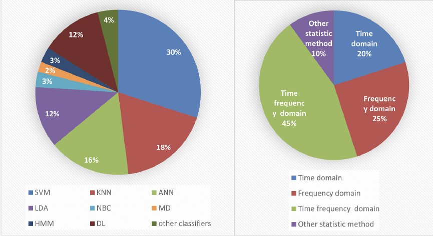

**图 11｜运动想象综述：方法占比，而非准确率。** 来源：第 5 讲第 63 页，Pawan 与 Dhiman（2023）。

图中是方法使用占比：SVM 30%、KNN 18%，时频特征 45%、频域 25%。比较性能时，另看原实验的类别数、数据和划分条件。

## 6. MRI、BOLD、PET、fNIRS

### MRI 成像

- 主磁场 B₀ 建立净磁化，射频脉冲激发，线圈接收磁共振信号。
- 梯度让磁场随位置变化，以频率或相位编码位置，再重建图像。
- 拉莫尔频率与磁场强度成正比。
- **k 空间**存放空间频率信息；中心描述缓慢变化，外围包含细节。采样间隔影响视野，覆盖范围影响分辨能力。

### BOLD 与实验设计

神经活动 → 血流、血容量和氧代谢变化 → 脱氧血红蛋白影响局部磁环境 → T2* 加权 MRI 信号变化。

典型正 BOLD 响应中，血流补偿降低脱氧血红蛋白的相对影响，去相位减弱，信号增强。血流响应在数秒尺度，提高采集频率可更密集地记录它。

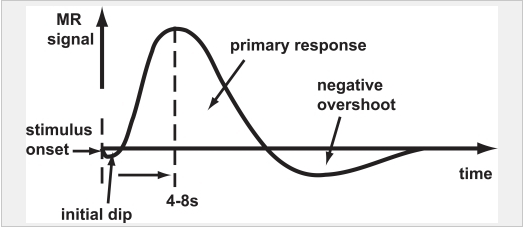

**图 12｜血流动力学响应：神经事件之后的慢变化。** 来源：第 6 讲第 35 页。

**HRF（血流动力学响应函数）**描述短暂事件引起的慢响应。简化预测为事件序列与 HRF 卷积，邻近事件的响应会重叠。

- 区块设计：同类条件连续出现，形成稳定对比。
- 事件相关设计：分别建模单个事件。
- 常见处理：运动校正、空间标准化、平滑、时间处理。
- 静息态：无指定显式任务，分析自发活动及区域间统计联系。

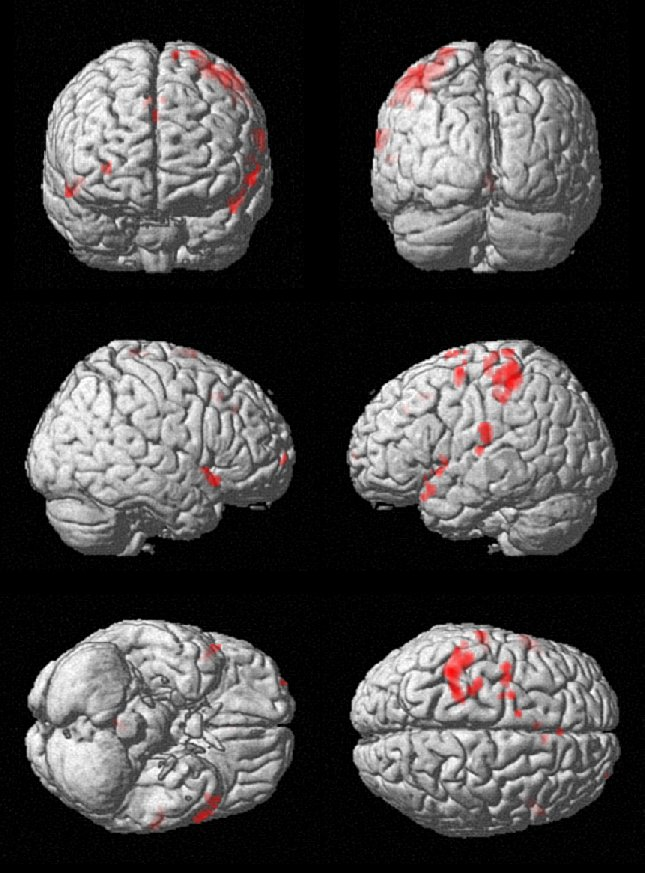

**图 13｜fMRI 彩色激活区是分析结果的显示。** 来源：第 6 讲第 49 页。

彩色区是达到显示标准的分析结果，灰色是解剖背景。脑区解释结合任务对比，检查头动等混杂。

**p 值**是在原假设和模型假设成立时，得到当前或更极端统计结果的概率。多体素检验需处理多重比较。

### PET 与 fNIRS

**PET**：示踪剂分布 → 正电子衰变 → 湮灭产生近乎反向的光子 → 符合探测 → 重建分布。核素决定衰变特性，被标记分子决定生理含义，如 FDG 用于葡萄糖代谢研究。

**fNIRS**：近红外光在组织内散射、吸收，利用不同波长吸收差异估计氧合与脱氧血红蛋白变化。便携，主要对浅层敏感，受头皮血流、头发和运动影响。

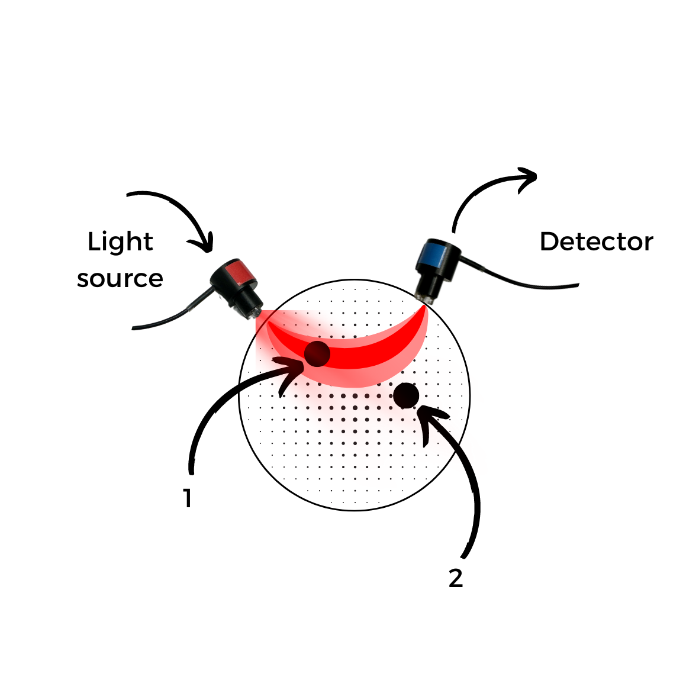

**图 14｜fNIRS 的光源、探测器与组织敏感区域。** 来源：第 6 讲第 83 页。

光源—探测器距离影响敏感区域；浓度估计依赖光吸收和传播模型。

## 7. 电生理记录与伪迹

### EEG 参考和来源

- 通道电压 V=V记录−V参考，参考变化会影响波形。
- **10–20 系统**按头部标志点和比例布置电极。
- **体积传导**：同一来源经组织传播到多个电极，产生通道间共同成分。
- 功能连接分析要考虑共同来源与参考，相关性描述统计联系。

常见频段：δ 约 0.5–4 Hz，θ 4–8 Hz，α 8–13 Hz，β 13–30 Hz，γ 为 30 Hz 以上的一段范围。边界与解释随研究任务调整。

### 伪迹

| 来源 | 影响 |
|---|---|
| 眨眼、眼动 | 眼电混入 EEG |
| 咬牙、面部肌肉 | 肌电干扰，尤其影响高频分析 |
| 工频 | 50/60 Hz 周期干扰 |
| 头动、接触不良 | 漂移、突变、饱和 |

伪迹与标签同步时会成为分类线索。检查辅助记录、实验对照及划分方式，判断模型用了什么信息。

### MEG 与植入记录

MEG 对来源方向的敏感性与 EEG 不同，受组织电导率边界影响较小。**SQUID、OPM** 是磁场传感技术，需抑制环境磁噪声。

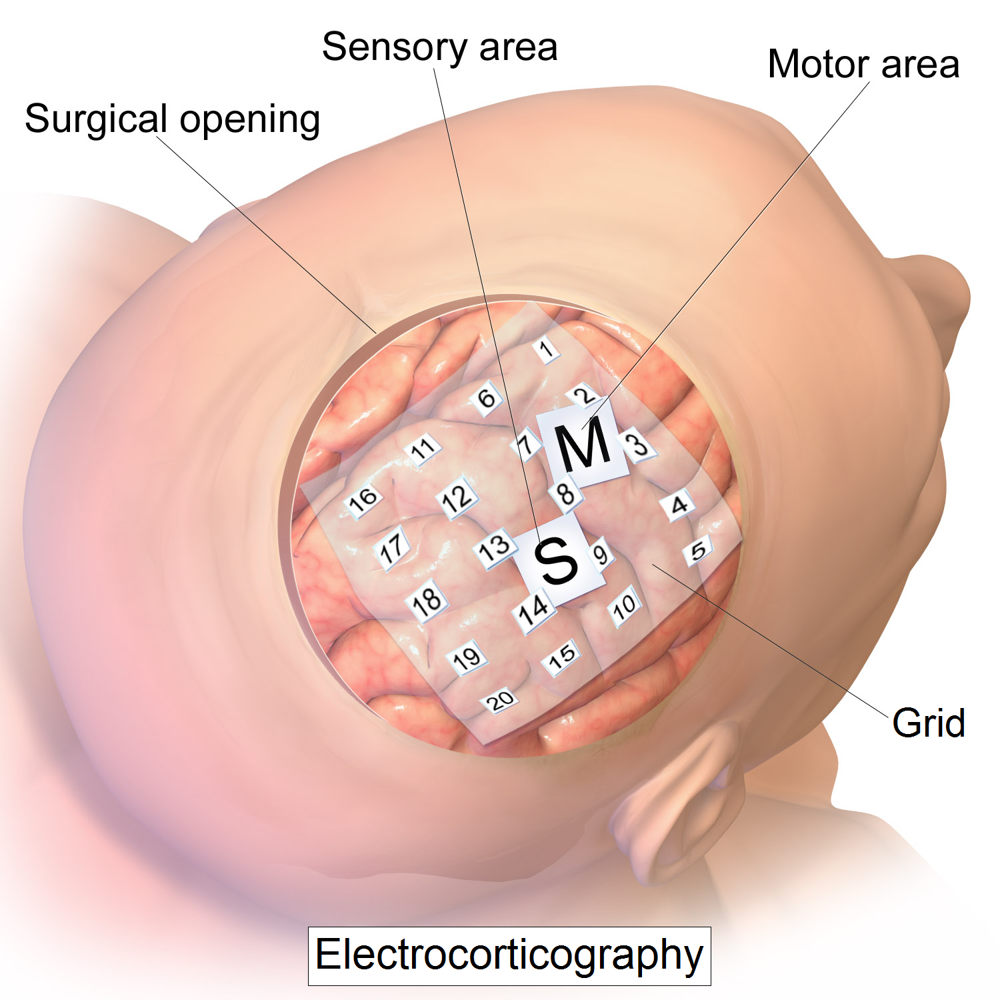

**图 15｜ECoG 电极位于皮层表面。** 来源：第 7 讲第 59 页。

ECoG 电极位于皮层表面，覆盖范围决定可观察区域。

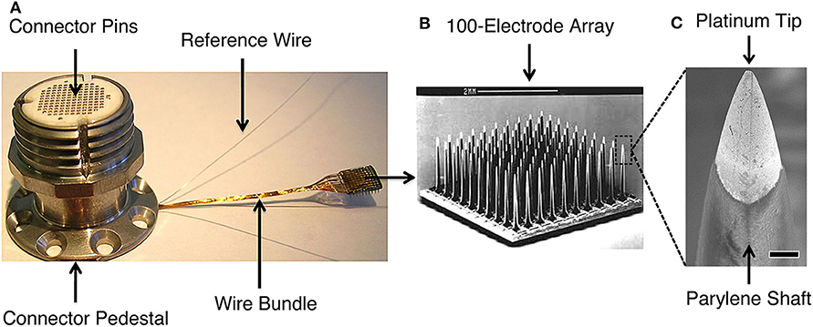

**图 16｜皮层内阵列：连接器、针阵列和电极尖端。** 来源：第 7 讲第 82 页。

皮层内微电极进入组织，记录尖峰和局部场电位。电极与神经元可多对多；**尖峰分选**按波形等特征估计细胞来源。电极微移、胶质反应和包裹会改变长期记录。

### 源定位

正问题：由脑内来源预测传感器信号。逆问题：由传感器信号估计来源。

多个来源组合可产生相似观测，因此源定位需要头模型和约束。波束形成、最小范数等方法采用不同约束得到估计结果。

## 8. 读论文与汇报

阅读顺序：摘要、引言 → 关键图和结果 → 讨论 → 方法细节。

读完记下：研究问题、数据来源、输入输出、方法改动、测试划分、关键成绩及其条件。

### 评价重点

- 同人新片段、跨天、跨人对应不同泛化能力。
- 重叠窗口跨训练与测试会共享信息；标准化参数通常只在训练集估计。
- 测试域数据用于适应时，记录其标签和用途；检查刺激图片、序列、区块是否跨集合重复。
- 70%→78% 是增加 8 个百分点，相对提升约 11.4%。
- 类别不平衡时，同时看混淆矩阵和各类召回率。
- **消融实验**去掉或替换模块，在相同条件下检查贡献。
- 统计显著性、提升幅度、运行稳定性分别报告。

论文报告已完成的证据，提案交代问题、方法和成功标准。向老师汇报时围绕“现有问题—方法改动—对照实验—结果”组织，每幅图说清坐标和结论。

## 9. 硬件与 TinyML

### 采集链路

电极 → 输入保护、放大 → 模拟滤波 → ADC → 数字处理与预测 → 通信或执行。

- 高输入阻抗：减少测量电路对信号来源的负载。
- 共模抑制：压低两个输入共同携带的干扰。
- 偏置/DRL：帮助控制身体共模电位。
- 前置增益：利用 ADC 量程，降低后级噪声和量化误差的相对影响。信号与已有噪声同倍放大时，信噪比不变。
- 增益过大会饱和削顶，丢失峰值信息。
- b 位 ADC 理想上有 2^b 个等级，步长约为量程宽度/2^b，有效精度受噪声等影响。
- 数据率约为通道数×采样率×位数；8×250×24=48000 bit/s，另有传输开销。

### 模型压缩

**TinyML** 将模型部署在资源受限的小设备，通常在计算机训练、设备端推理。

| 方法 | 原理 | 主要收益与条件 |
|---|---|---|
| 量化 | 降低权重或激活的位宽 | 节省存储，速度收益取决于硬件和算子 |
| 剪枝 | 删除权重、通道或结构 | 减少参数；实现需跳过对应计算 |
| 码本 | 用代表值和索引存储 | 压缩重复或相近数值，计入码本开销 |
| 蒸馏 | 学生学习教师输出或特征 | 用小模型承接教师知识，学生需训练 |

相同参数数目下，FP32→INT8 的纯权重存储约为四分之一。

**PTQ** 是训练后量化；**QAT** 在训练中模拟量化误差。逐通道量化为不同通道设置尺度，适应不同数值范围。

量化把数值放到有限刻度：步长 0.1 时，0.26 近似为 0.3，误差 0.04。量程越宽、等级固定时，刻度越粗。

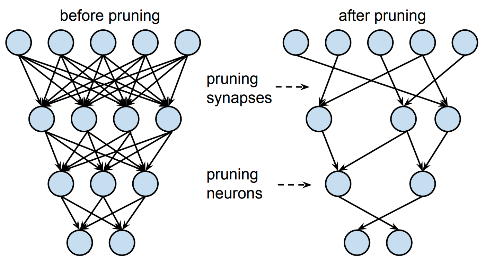

**图 17｜剪枝：删除连接与删除整个神经元。** 来源：第 9 讲第 71 页。

单权重置零形成非结构化稀疏，删除通道形成结构化剪枝，后者通常更方便普通硬件利用。

### 延迟

端到端延迟包含窗口采集、缓冲、滤波、传输、推理和执行器响应。窗口长度与输出更新间隔分别记录。

RC 时间常数 τ=RC 决定充放电速度，滤波器有群延迟。最终在设备上测延迟、功耗、丢包和稳定性。

## 10. 长期使用与自适应

- **非平稳**：疲劳、注意、电极和策略变化使输入分布改变，旧解码器表现退化。
- **域适应**：调整表示或模型，减少新旧数据分布差异。
- **共同适应**：用户学习控制策略，模型也适应用户。
- **共享控制**：脑信号提供目标，设备利用环境信息完成部分路径或动作。
- **错误相关电位**：用户察觉错误时的相关响应，可作为反馈线索。

在线更新使用可信标签或反馈，并监测性能、保留回退机制，避免错误预测反复进入训练。

评价自适应时，与固定模型和简单重新校准比较；记录新一天使用了多少标签与数据。实际使用还看目标完成时间、失败率、延迟、功耗、佩戴和校准成本。

课题联系：学习能区分任务、又能跨天保持一致的表示。用独立测试检查任务信息是否保留，再评价复杂方法带来的实际收益。

## 出处

按十讲课件整理；第五讲保留此前核对的原文补充和勘误。图片均来自课件，论文链接见各节。

| 来源 | 重点回查页 |
|---|---|
| lecture_01 (8).pptx | 7–18、21–42：定义、测量方式、接口与 AI |
| lecture_02.pptx | 30–34、39–55、59–83：学习方式、模型、任务 |
| lecture_03 (1).pptx | 9–49：信号、系统、能量、卷积、傅里叶、采样 |
| lecture_04 (1).pptx | 25–49：神经元、可塑性、动作电位与 ERP |
| lecture_05 (1).pptx | 3–64：序列解码、生成模型、跨天对齐；45–53 页需结合勘误 |
| lecture_06 (1).pptx | 9–53、55–78、80–99：MRI/BOLD、PET、fNIRS |
| lecture_07 (1).pptx | 3–27、34–55、58–90：EEG、MEG、ECoG、微电极 |
| lecture_08 (1).pptx | 6–26、28–36：读写论文与汇报 |
| lecture_09.pptx | 3–26、29–106、108–112：采集链、TinyML、压缩、提案 |
| lecture_10.pptx | 29–58、60–66：部署、自适应、研究提案 |
